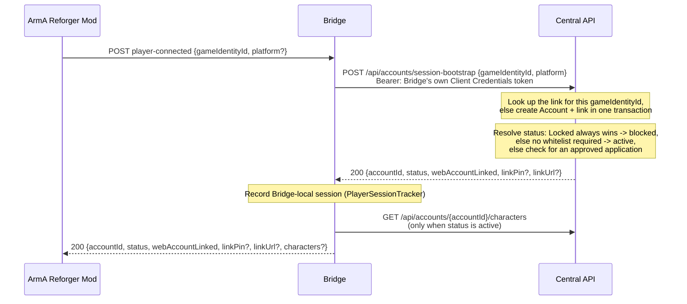

# Login & Session Bootstrap

`POST player-connected {gameIdentityId, platform?}` is the first thing that happens when a player
connects to the gameserver — it resolves (or creates) that player's account via the Central API and
starts a Bridge-local session for them.

`gameIdentityId` is the player's **per-platform** Game Identity ID, which is what the gameserver
reports. It is *not* their Bohemia account: Reforger mints a Game Identity per game-platform
combination, so one player on PC, Xbox and PlayStation has three, and all three can be linked to a
single ELifeRPG account. `platform` is optional and descriptive — Core records it on the link for
staff and ignores a value it does not recognise.

## Sequence

## Account creation on first contact

If no link exists yet for the given `gameIdentityId`, Core creates an account and its first link in
one transaction. **No Keycloak user is provisioned** — joining is enough to play, and the web
identity is attached later if the player ever links one. Core checks Keycloak for an existing
binding *before* creating anything, so a player who signed up on the portal first is found rather
than given a silent second account.

## The `status` values

`status` is the play gate and only that. Core resolves it in a fixed order:

| `status` | When |
|---|---|
| `blocked` | The account is `Locked` — this always wins, even over an approved whitelist application. |
| `active` | Not locked, and either the calling gameserver doesn't require whitelisting, or it does and this account has an `Approved` application for it. |
| `not_whitelisted` | Not locked, the gameserver requires whitelisting, and this account has no `Approved` application for it. |
| `unlinked` | Core could not resolve the identity at all and **created nothing**. Retry. |

`unlinked` is the one to read carefully: it used to mean "a player Core has never seen", and no
longer does. In practice it means Keycloak was unreachable on a first-ever join, so Core could not
check for an existing binding and refused to risk inventing a second account for the same player.
It carries no `accountId`, and no session is tracked.

Core may add a status; the Bridge maps an unrecognised one to `unknown` rather than failing the
call (`PlayerSessionStatuses.FromCentralApi`). `unlinked` itself arrived that way, and a strict
parse would have turned every unlinked player into a 500.

## Offering the web link

`webAccountLinked` — **not `status`** — is what the mod branches on to offer linking. A player who
has never touched the web portal still reads `active` and plays normally, so keying the prompt off
`status` would mean it never appears.

When `webAccountLinked` is `false`, the response carries two ways to link, set and cleared together:

- `linkUrl` — does the whole flow in a browser, PIN prefilled. It is a bearer credential for that
  game identity for as long as the PIN lives, so show it on demand (copy-to-clipboard) rather than
  parking it on screen.
- `linkPin` — the same eight characters, for a player who would rather type them into the portal.

Both are null once linked, and also when Keycloak declined to mint a PIN or was unreachable — in
which case the player simply rejoins. Keycloak being down stops linking, never playing.

## Why a session is still tracked for a blocked or not-yet-whitelisted player

`player-connected` records the Bridge-local session (`PlayerSessionTracker`, in-memory, keyed by
`gameIdentityId`) whenever Core returns an `accountId` — even when `status` isn't `active`. Session
tracking means "this Game Identity ID is currently connected and maps to this `AccountId`", not "may
play". That lets every later mod-facing endpoint resolve the `AccountId` from the session instead of
re-asking Core, and lets the mod show a blocked player why.

## What ends the session

The counterpart to this page is disconnect: `player-disconnected` ends the Bridge's local record of
the connection, and ends whatever character session was last selected. See [Workflows](index.md) for
a short summary of that and the other Bridge-mediated interactions.
